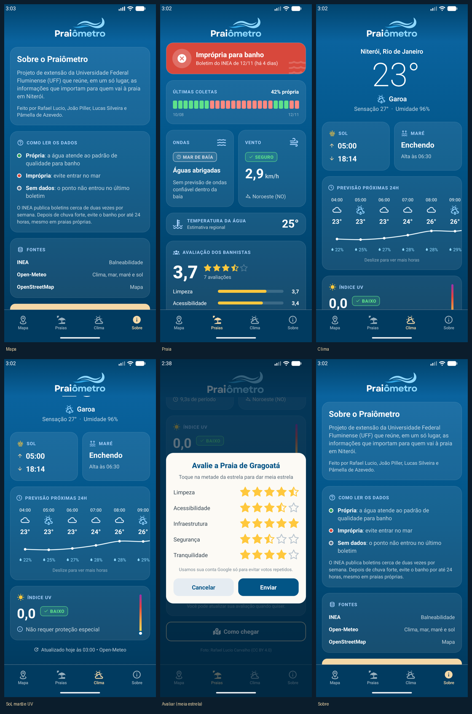

# Praiômetro

[](https://github.com/joaopiller/praiometro/actions/workflows/backend.yml)
[](https://github.com/joaopiller/praiometro/actions/workflows/frontend.yml)

App com informações das praias de Niterói e do Rio de Janeiro (Zona Sul e Sudoeste): balneabilidade, ondas, vento, índice UV, previsão do tempo e avaliações dos banhistas, tudo em um só lugar.

O Praiômetro é um projeto de extensão da Universidade Federal Fluminense (UFF), desenvolvido por alunos de Sistemas de Informação.



## Funcionalidades

- 36 praias: as 14 de Niterói e 22 do Rio, da Barra de Guaratiba ao Flamengo
- O app abre na cidade onde você está (pela localização, pedida uma vez); dá para trocar de cidade no mapa e no clima
- Mapa com um pin por praia no meio da faixa de areia, colorido pela situação, e carrossel que percorre o litoral de cada cidade
- Situação para banho de cada praia: própria, imprópria ou parcialmente própria, quando os trechos medidos pelo INEA (68 pontos de coleta) discordam
- Trechos de cada praia com a situação de cada um e o histórico das últimas coletas
- Aviso quando choveu recentemente
- Praia mais próxima de você (no mapa e na lista)
- Ondas (nas praias oceânicas), vento, temperatura da água, índice UV e previsão para as próximas 24 horas
- Clima por área da cidade (em Niterói, Centro e baía ou Região Oceânica; no Rio, Zona Sul ou Barra e Recreio), maré e nascer/pôr do sol
- Avaliação das praias pelos usuários (limpeza, acessibilidade, infraestrutura, segurança e tranquilidade), com meia estrela
- Relatos rápidos de quem está na praia (lotada, água limpa, água-viva, bandeira vermelha...), vários de uma vez, que expiram em 5 horas
- Busca sem acento por praia, bairro, cidade ou rua de referência, com as praias separadas por cidade (a sua primeiro), e filtros de praias próprias para banho e mais próximas
- Login com Google (e com Apple no iPhone) para avaliar e relatar; o app lembra da conta, então não é preciso entrar a cada vez
- Funciona offline com os últimos dados baixados

## Fontes de dados

| Dado | Fonte |
| --- | --- |
| Balneabilidade e histórico | Boletins do INEA para [Niterói](https://www.inea.rj.gov.br/niteroi/) e para a [Zona Sul e Sudoeste do Rio](https://www.inea.rj.gov.br/rio-de-janeiro/) |
| Clima, ondas, maré, temperatura da água e sol | [Open-Meteo](https://open-meteo.com/) |
| Mapa | [OpenFreeMap](https://openfreemap.org/) + MapLibre (dados do OpenStreetMap; os créditos ficam na tela Sobre do app) |
| Fotos das praias do Rio | [Wikimedia Commons](https://commons.wikimedia.org/), em domínio público ou licenças Creative Commons; autor e licença de cada foto aparecem na página da praia |

Limitações conhecidas:

- O boletim do INEA reflete as últimas coletas (cerca de duas por semana), não o dia de hoje.
- O modelo de ondas da Open-Meteo tem resolução de ~5 km e não representa o interior da Baía de Guanabara; por isso as praias da baía não exibem altura de onda.
- O modelo de clima tem resolução de cerca de 10 km: as praias da baía compartilham uma célula e as da Região Oceânica outra (no Rio, a Zona Sul e a Barra). Por isso a aba Clima oferece duas áreas por cidade.
- Maré e temperatura da água são previsões de modelo, não medições.

## Estrutura

```
praiometro/
├── backend/                 API (FastAPI) e worker de coleta (Python)
│   ├── praiometro/
│   │   ├── api/             rotas, schemas, cache e rate limit
│   │   ├── coleta/          Open-Meteo, INEA e consolidação dos dados
│   │   ├── dados/praias.json  catálogo fixo dos pontos de coleta
│   │   ├── avaliacoes.py    votos e médias (MongoDB)
│   │   └── worker.py        tarefas agendadas
│   ├── scripts/             utilitários de desenvolvimento
│   └── tests/
├── frontend/                app mobile (Expo / React Native + TypeScript)
│   ├── src/
│   │   ├── api/             cliente HTTP e tipos
│   │   ├── components/
│   │   ├── hooks/           consultas com React Query
│   │   ├── navigation/
│   │   ├── screens/
│   │   ├── theme/           cores, espaçamentos, tipografia
│   │   └── utils/
│   └── app.config.ts
├── docker-compose.yml       MongoDB + API + worker
└── .github/workflows/       CI/CD
```

## Backend

### Com Docker (recomendado)

```bash
cp backend/.env.example backend/.env   # ajuste o GOOGLE_CLIENT_ID
docker compose up -d --build
```

A API sobe em `http://localhost:8000` (documentação interativa em `/docs`). O worker faz a primeira coleta assim que inicia e depois repete a cada hora (o histórico do INEA é atualizado a cada 6 horas). Os arquivos gerados ficam na pasta definida por `DATA_DIR`.

### Na nuvem, de graça (Render + MongoDB Atlas)

O [`render.yaml`](render.yaml) publica o backend no plano gratuito do [Render](https://render.com), com as avaliações e os relatos num cluster gratuito do [MongoDB Atlas](https://www.mongodb.com/cloud/atlas/register).

1. **Atlas:** crie o cluster gratuito, um usuário do banco (senha só com letras e números) e, em *Network Access*, libere `0.0.0.0/0` (o Render gratuito não tem IP fixo). Em *Connect → Drivers* copie o endereço `mongodb+srv://...`.
2. **Render:** *New → Blueprint*, escolha este repositório e preencha `MONGO_URI` (o endereço do Atlas) e `GOOGLE_CLIENT_ID`.
3. **Manter acordado:** o serviço gratuito dorme depois de 15 minutos sem acesso e leva cerca de um minuto para voltar. Um monitor gratuito (por exemplo o [UptimeRobot](https://uptimerobot.com)) chamando `/health` a cada 5 minutos evita isso.
4. **App:** aponte o `EXPO_PUBLIC_API_URL` do frontend para o endereço `https://...onrender.com`.

**Ponte em São Paulo.** O site do INEA só responde a endereços do Brasil, e o Open-Meteo conta o limite de acessos por endereço (o do Render gratuito é dividido com outros usuários). Por isso a coleta, quando roda fora do país, passa pela função em [`ponte/`](ponte), publicada na [Vercel](https://vercel.com) na região de São Paulo: importe o repositório com *Root Directory* `ponte`, defina a variável `PONTE_CHAVE` (uma senha qualquer) e, no backend, `PONTE_URL=https://<projeto>.vercel.app/api/buscar` e a mesma `PONTE_CHAVE`. A ponte só busca páginas do INEA e do Open-Meteo, e só com a chave. O `/health` do backend mostra como foi a última tentativa em cada fonte.

No plano gratuito há um serviço só e o disco é apagado a cada reinício. Por isso o `render.yaml` liga `COLETOR_EMBUTIDO=true`: a coleta roda dentro da própria API e refaz os dados ao iniciar (enquanto isso, a API responde com o catálogo, sem leituras). Avaliações e relatos ficam no Atlas e não se perdem.

### Sem Docker

Requer Python 3.11+ e um MongoDB rodando.

```bash
cd backend
python -m venv .venv && source .venv/bin/activate
pip install -e ".[dev]"
cp .env.example .env

praiometro-worker   # coleta (deixe rodando)
praiometro-api      # API, em outro terminal
```

Para gerar avaliações falsas durante o desenvolvimento: `python scripts/popular_banco.py`.

### Testes

```bash
cd backend
pytest --cov
ruff check . && ruff format --check .
```

### Endpoints

| Método | Rota | Descrição |
| --- | --- | --- |
| GET | `/health` | Status da API e do MongoDB |
| GET | `/praias` | As 36 praias, com cidade, bairro, a situação geral, o pin no mapa e cada ponto de coleta |
| GET | `/praias/{id}` | Uma praia, com leitura atual e previsão de 24h do ponto principal |
| GET | `/praias/{id}/avaliacao` | Médias das avaliações da praia |
| GET | `/praias/{id}/relatos` | Relatos ativos, agrupados por tipo |
| POST | `/praias/{id}/relatos` | Envia um ou vários relatos (`{"tipos": [...], "latitude", "longitude"}`; exige login e estar a até 2 km da faixa da praia) |
| POST | `/praias/{id}/relatos/{tipo}/denuncia` | Contesta um relato |
| POST | `/votar?praia_id=...` | Envia/atualiza uma avaliação (header `Authorization: Bearer <id_token>`) |
| GET | `/pontos` | Os 68 pontos de coleta com a balneabilidade atual |
| GET | `/pontos/{codigo}` | Leitura atual e previsão de 24h de um ponto |
| GET | `/pontos/{codigo}/dados?tipo=meteo\|marine\|ambos` | Apenas os indicadores |
| GET | `/pontos/{codigo}/historico?dias=365` | Histórico de balneabilidade de um ponto |
| GET | `/regiao` | Maré e nascer/pôr do sol |

Em Niterói, o id da praia são as duas letras do começo do código dos pontos (`IC` para Icaraí, cujos pontos são `IC00`, `IC001`...); no Rio, onde várias praias dividem o mesmo prefixo, é um nome (`copacabana`, `sao-conrado`). Cada ponto do catálogo (`praiometro/dados/praias.json`) diz a cidade, a praia e o bairro. `/praias/{id}` também aceita o código de um ponto e responde com a praia dele. As avaliações e os relatos são da praia; as rotas antigas por ponto (`/pontos/{codigo}/avaliacao` e `/pontos/{codigo}/relatos`) continuam respondendo pela praia do ponto.

O pin de cada praia fica em `praiometro/dados/centro_das_praias.json`, gerado por `scripts/centro_das_praias.py` a partir dos contornos de areia do OpenStreetMap (um ou mais arquivos do Overpass, por exemplo um por cidade): o ponto bem dentro da areia mais perto do meio da praia.

Cada cidade tem o próprio boletim do INEA. A página do Rio publica vários (um por região), e o worker baixa só o da Zona Sul e Sudoeste. Os códigos dos pontos são normalizados para três dígitos (`BG00` vira `BG000`).

### Moderação dos relatos

Os relatos são opções fixas, sem texto livre, então não há conteúdo ofensivo para moderar. Contra relatos falsos:

- cada relato expira em 5 horas (índice TTL no MongoDB);
- é preciso estar logado e a até 2 km da praia (da linha que liga os pontos de coleta, para valer no meio das praias compridas), verificado também no servidor;
- cada pessoa conta uma vez por tipo e praia a cada hora, com no máximo 12 relatos valendo ao mesmo tempo;
- opções opostas (lotada e tranquila, água limpa e água turva) não podem ir juntas;
- só dá para contestar um relato que está no ar; 3 contestações de pessoas diferentes escondem o relato, a menos que ele tenha mais confirmações do que contestações.

## Frontend

Feito com Expo SDK 58 (React Native 0.88). Requer Node 20+ e, para rodar no Android, Android Studio com JDK 17 ou 21. Para iOS, veja a seção [iOS](#ios).

```bash
cd frontend
npm install
npm run setup:env        # cria o .env apontando a API para o IP desta máquina
npm run android          # gera o projeto nativo e abre no emulador/celular
```

As configurações ficam no `.env` (veja `.env.example`):

- `EXPO_PUBLIC_API_URL`: endereço da API. No emulador, `http://10.0.2.2:8000` aponta para o seu computador.
- `EXPO_PUBLIC_GOOGLE_WEB_CLIENT_ID`: Web Client ID do Google, usado no login para avaliar e relatar.
- `EXPO_PUBLIC_GOOGLE_IOS_CLIENT_ID`: ID do cliente iOS do Google (só para builds iOS).

### Login com Google

O login (usado para avaliar e relatar) depende de um projeto no [Google Cloud](https://console.cloud.google.com), em **Google Auth Platform**:

1. **Público-alvo:** externo. Enquanto o app estiver "Em teste", só os e-mails em *Usuários de teste* conseguem entrar.
2. **Clientes → Aplicativo da Web:** o ID gerado é o `EXPO_PUBLIC_GOOGLE_WEB_CLIENT_ID` do frontend e o `GOOGLE_CLIENT_ID` do backend (o mesmo valor nos dois).
3. **Clientes → Android:** pacote `com.praiometro.app` e o SHA-1 do certificado que assina o app. Um cliente para cada certificado:
   - desenvolvimento: `5E:8F:16:06:2E:A3:CD:2C:4A:0D:54:78:76:BA:A6:F3:8C:AB:F6:25`;
   - produção (EAS): o SHA-1 mostrado por `eas credentials`.

4. **Clientes → iOS:** bundle ID `com.praiometro.app`. O ID gerado vai em `EXPO_PUBLIC_GOOGLE_IOS_CLIENT_ID`; o esquema de URL de retorno é derivado dele automaticamente.

Sem o cliente Android com o SHA-1 certo, o Google recusa o login com `DEVELOPER_ERROR`. O Client Secret não é usado.

### Login com Apple

No iPhone o app oferece "Entrar com a Apple" ao lado do Google, como exige a App Store para apps com login de terceiros. O app não pede nome nem e-mail; o backend valida o token com as chaves públicas da Apple e guarda o usuário como `apple:<id>`. A audiência esperada é o bundle ID, configurável em `APPLE_BUNDLE_ID` no backend. No Android a opção não aparece.

A pasta `android/` é gerada a partir do `app.config.ts` (`npm run prebuild`), então não precisa ser editada à mão.

### Imagens

Scripts em `frontend/scripts/` (requerem Python com Pillow: `pip install pillow`):

- `python scripts/comprimir-imagens.py`: reduz as fotos de `assets/images/praias` (e subpastas) para 1280 px de largura. Rode sempre que adicionar uma foto nova; ele não mexe no que já está otimizado.
- `python scripts/gerar-icones.py`: leva a logo de `docs/identidade-visual` para o app (logo dos cabeçalhos, logo da abertura, ícone do app e ícones adaptativo e monocromático do Android).
- `python scripts/gerar-pins.py`: gera os pins do mapa (própria, imprópria, só em parte e sem dados, cada um com a versão selecionada).

### Identidade visual

A logo é o sol descendo sobre o mar, dentro de um selo. Em [docs/identidade-visual](docs/identidade-visual) ficam todas as versões, em SVG e PNG com fundo transparente (horizontal, vertical, compacta, só o ícone e só o nome; coloridas para fundo escuro e claro e em uma cor), os ícones do app e a [prancha](docs/identidade-visual/prancha.png) com cores e tipografia.

Os arquivos são gerados por `docs/identidade-visual/gerador/gerar.py` (requer `fonttools`, `uharfbuzz`, `pillow` e o Google Chrome, usado para renderizar os PNG). O nome usa a fonte Poppins Bold, de licença aberta (OFL), convertida em contorno. Depois de mudar a logo, rode `python scripts/gerar-icones.py` em `frontend/` e `npm run prebuild` para os ícones nativos.

### Testes e qualidade

```bash
npm run typecheck
npm run lint
npm test
```

### iOS

O mesmo código gera o app de iOS. Para compilar localmente é preciso um Mac com Xcode e CocoaPods:

```bash
npm run ios              # gera o projeto nativo e abre no simulador
```

No simulador a API do computador responde em `http://localhost:8000`; num iPhone de verdade use o IP da rede local (`npm run setup:env`).

Para instalar no próprio iPhone com uma conta Apple gratuita (Personal Team), coloque `EXPO_PUBLIC_LOGIN_APPLE=false` no `.env`: o Xcode não assina apps com login da Apple nesse tipo de conta. O login com Google continua funcionando.

```bash
npx expo prebuild -p ios --clean
npx expo run:ios --device --configuration Release
```

No iOS 26 em diante o app usa o visual Liquid Glass do sistema: a barra de abas é a nativa do iOS (ícones SF Symbols) e o cabeçalho do mapa, os botões flutuantes e a busca são de vidro (`expo-glass-effect`). Em versões anteriores e no Android o visual continua o mesmo de antes.

Também dá para gerar na nuvem pelo EAS, sem Xcode:

- `eas build -p ios --profile simulador`: build para o simulador, não precisa de conta Apple.
- `eas build -p ios --profile preview`: instala no iPhone por link (distribuição interna). Precisa da conta Apple Developer e do aparelho registrado com `eas device:create`.
- `eas build -p ios --profile production` + `eas submit -p ios`: envia para o TestFlight e a App Store.

Em desenvolvimento a API pode ser HTTP na rede local (o app libera isso só quando `EXPO_PUBLIC_API_URL` começa com `http://`); em produção ela precisa de HTTPS.

### Gerar builds

```bash
npm install -g eas-cli
eas build --platform android --profile preview   # APK
eas build --platform ios --profile preview        # iPhone (distribuição interna)
```

## CI/CD

- **Backend** (`.github/workflows/backend.yml`): lint, testes com cobertura e build da imagem Docker. Em pushes na `main`, a imagem é publicada no GitHub Container Registry.
- **Frontend** (`.github/workflows/frontend.yml`): typecheck, lint, testes e validação do bundle.
- **Release do app** (`.github/workflows/eas-build.yml`): builds pelo EAS, disparado manualmente (escolhendo Android, iOS ou ambos) ou por tags `v*` (por enquanto só Android, até a conta Apple Developer estar no EAS). Precisa do secret `EXPO_TOKEN`.

## Autoria

<table>
  <tr>
    <td align="center">
      <a href="https://github.com/Disklo" title="Rafael Lucio">
        <br>
        <sub><b>Disklo (Rafael Lucio)</b></sub>
      </a>
    </td>
    <td align="center">
      <a href="https://github.com/joaopiller" title="João Vicente Piller">
        <br>
        <sub><b>joaopiller (João Vicente Piller)</b></sub>
      </a>
    </td>
    <td align="center">
      <a href="https://github.com/lucasilvr" title="Lucas Silveira">
        <br>
        <sub><b>lucasilvr (Lucas Silveira)</b></sub>
      </a>
    </td>
    <td align="center">
      <a href="https://github.com/azevedxpam" title="Pâmella de Azevedo">
        <br>
        <sub><b>azevedxpam (Pâmella de Azevedo)</b></sub>
      </a>
    </td>
  </tr>
</table>

## Licença

Distribuído sob a licença MIT. Veja [LICENSE](LICENSE).
